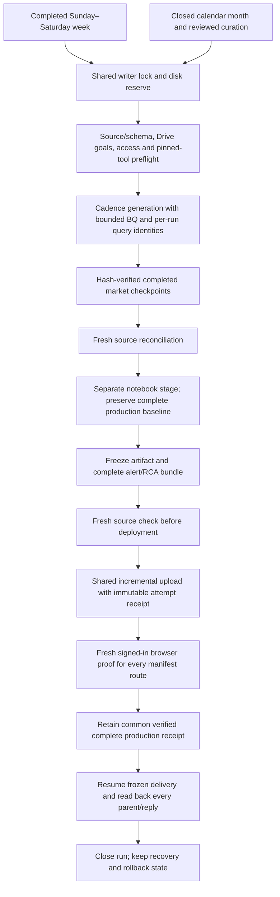

# Shared report reliability — 17 November 2026

## Purpose and boundaries

Weekly and monthly remain two cadence engines. They now share metric operand and
target definitions, bounded execution, query/build checkpoints, deployment
transport, production-baseline receipts, writer locking and storage preflights.
No source migration, metric rewrite, bucket change, historical regeneration,
Mini Audit mutation, cache deletion or production replay is part of this change.
The monthly checkpoint commit retains the previously deployed working fixes;
the reliability change builds on that checkpoint rather than discarding it.

## Supported flow

Generation remains read-only against BigQuery. Preparation stages do not send
Slack or deploy. Browser proof is a deliberate human/browser boundary, not a
headless-authentication bypass. A passing local suite is not an unattended run.

## Changes and why

| Layer | New rule | Limits |
|---|---|---|
| Overall ROI operands | One inventory of 15 ad-cost fields and 5 other marketing costs | Weekly retains its prior NULL policy; monthly retains COALESCE on every cost. Only the two omitted monthly Bing fields are added. Paid Search definitions and bucket engines are unchanged. |
| OKR targets | Both use the verified 2026 company targets and exact market GEL allocations | Q4 Headout GEL is +90% (H2 2026 G30). No invented 2027 target, ownership-group split or company-to-market fallback. |
| OKR status | Shared central GEL progress policy | Monthly Pro+ status is unavailable until it has the necessary projection evidence; raw counts and approved targets remain. Historical facts are not rewritten. |
| Monthly economics | Negative/non-finite source check before generation; fresh revenue, MoM/YoY and ROI comparison before freeze and before deploy | Uses monthly calendar boundaries and its existing dimension/market mapping. Fresh checks cannot inherit cached producer jobs. |
| Network | BQ HTTP requests have 15s connect/60s read limits and result waits have a 900s limit | Existing SDK retry behavior remains; whole stages also have finite budgets. This does not guarantee upstream availability. |
| Query cap | Shared enforced maximum of 80 GiB, including global drawers | An old 140 GiB global override was removed. Any genuine scan over 80 GiB stops; it is not silently raised or replaced with zero. |
| Query recovery | A run journal stores query digest/config and acknowledged BQ job ID | It never serializes source rows. Unknown submissions, failed jobs, missing jobs or identity mismatches stop rather than requerying. Source verification always reads fresh. |
| Market recovery | Completed weekly snapshots and monthly build artifacts have per-run hash checkpoints | Changed/missing completed output or changed source/curation blocks reuse. An unfinished build is not declared complete. |
| Runtime | One bootstrap applies only inside report Python processes and their script children | Normal Python startup/site packages, TLS/proxy/auth configuration and the analytics checkout are untouched. No sitecustomize override. |
| Stage failure | Finite stage deadline; terminate its whole process group before releasing writer lock; local failure notification | The Mac must permit notifications. There is no external messaging service or new background daemon. |
| Upload | Reviewed Vercel 52.0.0 + Node 24 for both; lazy content-addressed hashing and bounded missing-file upload | Keeps full preserved notebook/routes, reuses provider hashes where available. No automatic archive fallback after an uncertain attempt. |
| Upload memory/budget | Keep only hash/size metadata for historical files; read/re-hash missing files at upload time | At most the active missing-file buffers, bounded concurrency. Stop if provider requests more than max(512 MiB, twice locally new unique bytes). Remote cache reuse is not assumed. |
| Deployment recovery | One immutable transport identity and deployment ID; bounded read-only observation | Existing archive attempts keep their recorded mode. Ambiguous legacy monthly attempts require their original reconciliation procedure. Never silently create a replacement deployment. |
| Monthly source preservation | Freeze 17 source-facts files with a hash manifest | Resumed checks use the frozen facts, not mutable analytics working data. Legacy packages are not retrofitted or regenerated. |
| Baseline handoff | After exact fresh browser proof, verify canonical deployment ID and write complete file-hash receipt plus common pointer | Pointer is a convenience, not independent authority. Recheck canonical ID and full retained tree each run. No manual monthly-to-weekly bridge needed for new releases. |

## Entry points and recovery

Weekly: `scripts/weekly_report/run_v2_release.py` remains canonical; inspect its
`--plan` with explicit week, complete verified base and separate stage.
Monthly: `engine/run_monthly_release.py` remains canonical; inspect `--plan`,
prepare into separate stage, then use its frozen `--resume` commands. Monthly
now calls `engine/monthly_upload.py`, never an unpinned global/npx deploy or the
old preupload chain.

A source/query/build checkpoint is evidence for safe reuse, not permission to
rerun an entire populated release package. Preserve the run receipt and use its
specific failed build command with its recorded runtime/journal when recovering
generation. Frozen packages resume transport/verification/delivery only. Never
clear query journals, transport receipts, complete artifact checkpoints, browser
proofs or delivery ledgers to force a retry. Changed code/curation must be
reviewed before reusing a run. Source identities cover the weekly and monthly
repositories plus the relevant analytics dependencies.

The shared baseline finalizer is a planned step after browser verification and
before delivery. When manually completing a browser pause, run this step as well
as the receipt's verification and immutable delivery commands. It acquires the
same writer lock when run standalone.

## Efficiency measurement and remaining proof

For the November 16 artifact, the local comparison to its retained monthly base
finds about 395 MiB of unique new report bytes versus a 652.7 MB compressed full
archive. This is an estimate, not a provider-cache hit measurement or a promised
upload duration. If old provider hashes have expired, the missing-byte budget
stops the incremental attempt before a large transfer; reconcile its identity
before any separate recovery upload.

Existing CoW staging, route storage sharing, no-legacy-HTML canonical generation,
soft retention classification, backup/reference verification and 30 GiB disk
reserve remain unchanged. This change does not delete the remaining duplicates
or optimize to an arbitrary cache total.

Verification evidence is under `.cache/report_reliability/2026-11-17/`.
Live read-only dependency verification passed (four schemas and 822 November
goal rows). Full regression suites, pinned-vendor upload fault injection and a
frozen weekly/monthly render/publish/preservation rehearsal are required before
handoff. Real upload/cache-hit duration, first fresh monthly generation on the
new cost contract, and one new release of each cadence remain live acceptance
checks; do not label a frozen rehearsal as those passes.

## Deliberate differences that remain

- Weekly uses Sunday–Saturday periods and weekday-aligned LY; monthly uses closed
  calendar months. Those windows must not be made artificially identical.
- Weekly CSEE/Nordics remains a shared page with two datasets. Monthly retains
  its approved combined market grain. No aggregation change is implied.
- Monthly's QTD actual plus remaining approved quarter targets is labelled a
  projection. It is not relabelled as the warehouse full-month forecast used by
  Weekly's Revenue Goals comparison.
- Monthly company Pro+ projection evidence is not fabricated from a current
  count. Adding the exact central history/qualification evidence is separate
  from these infrastructure changes.
- Sunday monitoring/new cloud scheduling and an always-on worker were not
  enabled. Existing recurring entrypoints execute the committed safeguards.
